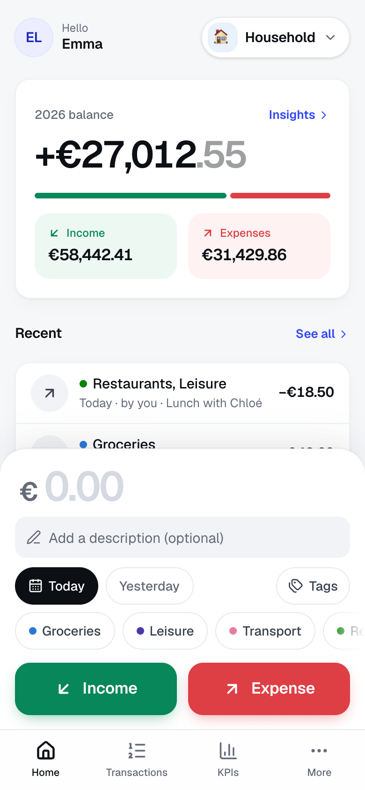
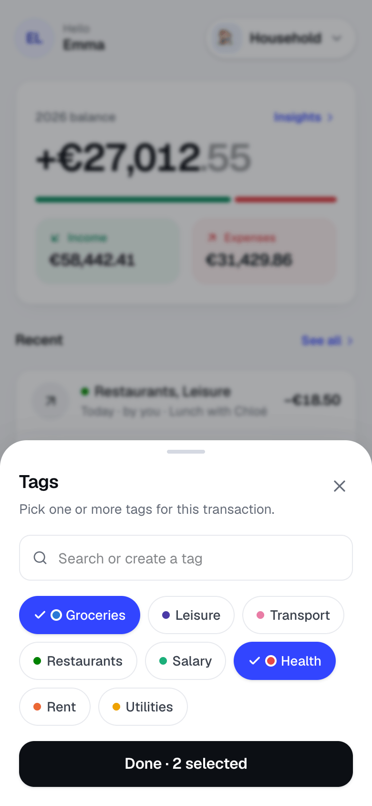
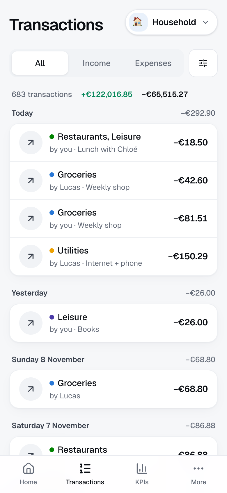
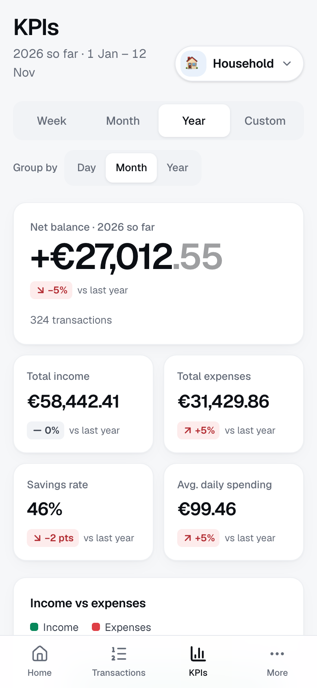
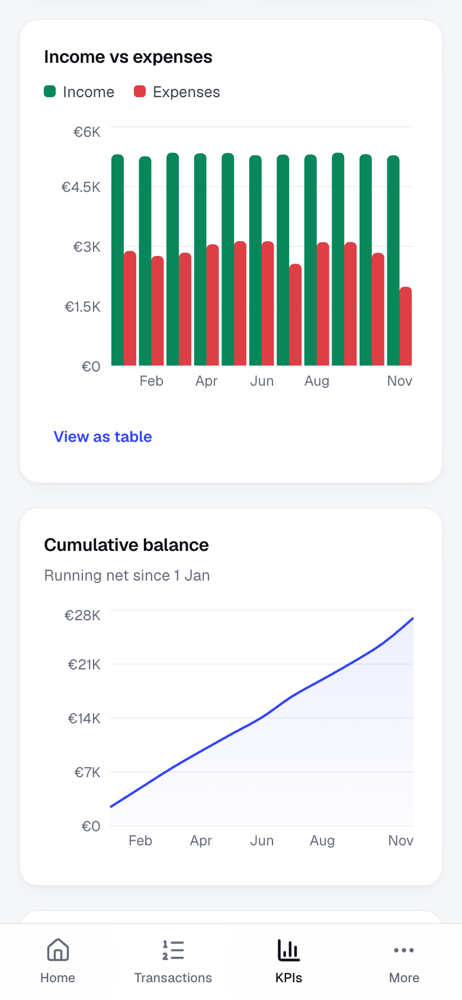
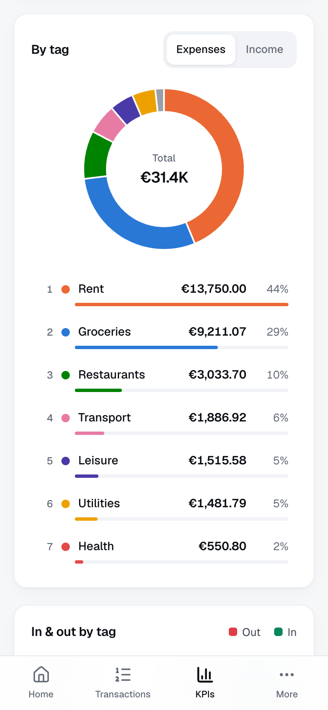
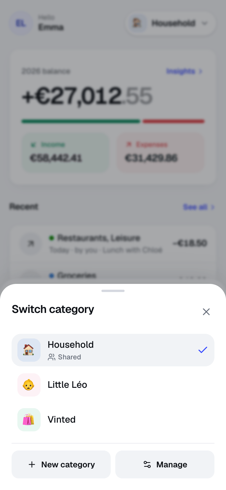
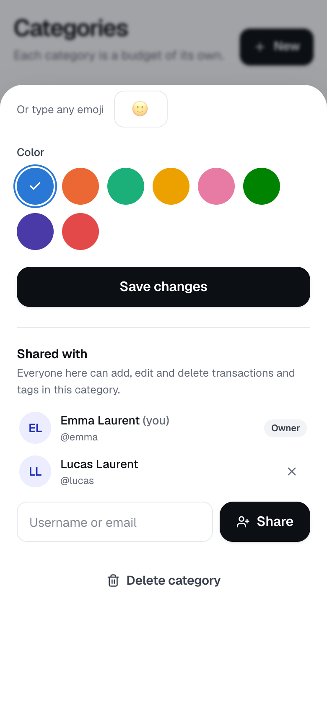
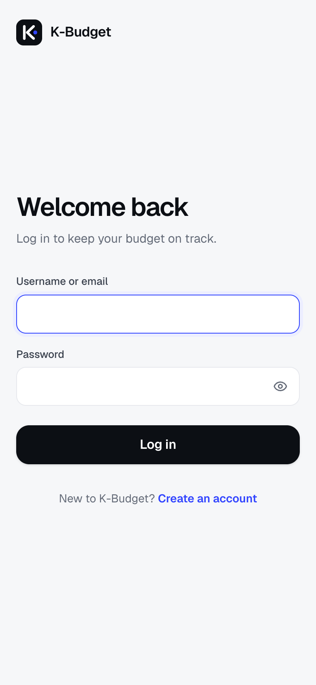

<div align="center">


# K-Budget

**Minimal, effortless personal budgeting.**<br />
Log a transaction in under five seconds, split your money into independent budgets,
share them with the people you live with — and actually understand where it goes.

[](LICENSE)


</div>

<br />

<table align="center">
  <tr>
    <td align="center" width="33%"></td>
    <td align="center" width="33%"></td>
    <td align="center" width="33%"></td>
  </tr>
  <tr>
    <td align="center"><b>Quick-add</b><br /><sub>Amount, description, tags — one tap</sub></td>
    <td align="center"><b>Tags</b><br /><sub>Search, multi-select, create on the fly</sub></td>
    <td align="center"><b>History</b><br /><sub>Grouped by day, with who added what</sub></td>
  </tr>
</table>

## Why K-Budget?

Most budgeting apps want you to connect your bank, categorise hundreds of lines and read a dashboard you
didn't ask for. K-Budget takes the opposite approach:

- **Fast by design** — the amount field is focused when the app opens; type it, tap **Income** or
  **Expense**, done. A toast lets you undo.
- **Budgets, not accounts** — a *category* is a budget of its own: _Household_, _My son_, _Vinted_,
  _Side hustle_… each with its own tags and numbers.
- **Built for two** — share a budget with your partner by username or email; every transaction shows who
  added it.
- **Clear numbers** — yearly balance on the home screen, and KPIs that compare each period with the previous one.

## Features

### ⚡ Quick-add
- Big numeric amount field (numeric keyboard on mobile), optional description, **Today / Yesterday** or any date
- Tags ordered by how often you use them; a searchable picker for the rest, where new tags can be created inline
- Saved instantly (optimistic UI) with an **Undo** toast — on desktop, `Enter` saves an expense and
  `Shift + Enter` an income

### 🗂️ Categories & tags
- Independent budgets with an emoji and a colour, switchable from anywhere in a bottom sheet
- Tags belong to one category; manage them per category, with all-time money in / out for each tag

### 👥 Sharing
- Share a category with another user by **username or email**
- Members can add, edit and delete transactions and tags; only the owner edits, shares or deletes the category
- Every transaction shows **who added it** ("by you", "by Lucas"); members can leave at any time

### 🧾 History
- Grouped by day with daily net, filters by type, tag and date range (presets included)
- Edit or delete any transaction

### 📊 KPIs
- Periods: week, month, year (to date) or a custom range; group by day, month or year
- Net balance, total income, total expenses, savings rate, average daily spending — each with its change vs the
  previous period
- Income vs expenses, cumulative balance, breakdown by tag (donut + ranking), **in & out per tag**, largest
  transactions — the time series can also be read as a table

<table align="center">
  <tr>
    <td align="center" width="33%"></td>
    <td align="center" width="33%"></td>
    <td align="center" width="33%"></td>
  </tr>
  <tr>
    <td align="center"><b>KPIs</b><br /><sub>Compared with the previous period</sub></td>
    <td align="center"><b>Trends</b><br /><sub>Income vs expenses, running balance</sub></td>
    <td align="center"><b>By tag</b><br /><sub>Where the money actually goes</sub></td>
  </tr>
</table>

### 📱 Installable
K-Budget is a **Progressive Web App**: open it in Chrome on Android (menu → _Install app_) or Safari on iOS
(Share → _Add to Home Screen_) and it runs full-screen like a native app, with shortcuts to Transactions and KPIs.

<table align="center">
  <tr>
    <td align="center" width="33%"></td>
    <td align="center" width="33%"></td>
    <td align="center" width="33%"></td>
  </tr>
  <tr>
    <td align="center"><b>Budgets</b><br /><sub>Switch in one tap</sub></td>
    <td align="center"><b>Sharing</b><br /><sub>By username or email</sub></td>
    <td align="center"><b>Accounts</b><br /><sub>Username or email login</sub></td>
  </tr>
</table>

<p align="center"><sub>Screenshots use fictional demo data.</sub></p>

## Getting started

**Requirements:** Node.js ≥ 20.9 and a MongoDB database — a free [MongoDB Atlas](https://www.mongodb.com/atlas)
cluster works, so does a local `mongod`.

```bash
git clone https://github.com/AbbaciKhaled/K-Budget.git
cd K-Budget
npm install
cp .env.example .env.local   # then fill in the values below
npm run dev                  # → http://localhost:3000
```

| Variable          | Description                                                                         |
| ----------------- | ----------------------------------------------------------------------------------- |
| `MONGODB_URI`     | MongoDB connection string, including the database name                              |
| `AUTH_SECRET`     | Random secret for session tokens — `npx auth secret` or `openssl rand -base64 32`   |
| `AUTH_TRUST_HOST` | `true` when running behind a proxy or in production                                 |
| `SIGNUP_ENABLED`  | Optional, defaults to `true`. Set to `false` for a private instance — no new accounts, existing ones can still log in |

Create an account, then your first category, and start logging. Want data to play with?
`npm run seed:demo -- <your-username>` adds ~14 months of random transactions to your account (dev only).

> `.env.local` is git-ignored — never commit it. In production, set these variables in your host's settings.

### Scripts

| Command                         | What it does                                                         |
| ------------------------------- | -------------------------------------------------------------------- |
| `npm run dev`                   | Development server (Turbopack)                                       |
| `npm run build` / `npm start`   | Production build / server                                            |
| `npm run lint`                  | ESLint                                                               |
| `npm run typecheck`             | Generates route types and runs `tsc --noEmit`                        |
| `npm run icons`                 | Regenerates the PWA icons                                            |
| `npm run seed:demo -- <user>`   | Adds random demo data to an existing account (development only)      |

### Deploying

Any Node.js host works — Netlify, Vercel, Render, a VPS. Set the three environment variables, let the host
reach your database (on Atlas: _Network Access_), and serve the app over **HTTPS** (required for the PWA and
secure cookies).

## Tech stack

| Layer      | Choice                                                                    |
| ---------- | ------------------------------------------------------------------------- |
| Framework  | [Next.js 16](https://nextjs.org) — App Router, Server Components, Server Actions, Turbopack |
| Language   | TypeScript (strict)                                                       |
| UI         | Tailwind CSS v4, [Geist](https://vercel.com/font), [Lucide](https://lucide.dev) icons |
| Charts     | [Recharts](https://recharts.org), colour-blind–safe palette               |
| Data       | MongoDB + Mongoose                                                        |
| Auth       | [Auth.js v5](https://authjs.dev) (credentials), bcrypt                    |
| Validation | [Zod](https://zod.dev), shared between client and server                  |

### Project structure

```
src/
├─ app/
│  ├─ (auth)/              login, signup
│  ├─ (app)/               home, transactions, kpis, categories, tags, profile (protected)
│  ├─ onboarding/          first-category screen
│  └─ api/                 Auth.js handlers, logout
├─ proxy.ts                route protection (Next 16 "proxy", formerly middleware)
├─ auth.ts, auth.config.ts Auth.js setup (full / edge-safe)
├─ models/                 User, Category, Tag, Transaction, RateLimit
├─ server/
│  ├─ actions/             Server Actions (mutations)
│  ├─ queries/             read side: summaries, history, KPI aggregations
│  ├─ access.ts            access rules — owner or member of a category
│  ├─ session.ts           current user, session revocation
│  └─ rateLimit.ts         brute-force protection
├─ lib/                    money (cents ↔ display), dates, periods, palette, Zod schemas
└─ components/             UI primitives + feature components
```

### Design notes

- **Money is stored in cents** (integers) — no floating-point surprises — and formatted with
  `Intl.NumberFormat`. A shared category uses its owner's currency.
- **Dates are calendar dates**, stored at UTC midnight and exchanged as `yyyy-mm-dd`.
- **Mobile-first**: bottom navigation and bottom sheets on phones, a sidebar layout on desktop, 44 px touch
  targets, visible focus states, AA contrast.

## Security

- Every query is scoped to the categories the user owns or is a member of; ids sent by the client are
  re-checked on the server, and all input is validated with Zod.
- Passwords are hashed with bcrypt. Login is rate-limited per account and per IP, sign-up per IP.
- Changing your password signs you out everywhere.
- Strict security headers (CSP, `X-Frame-Options`, HSTS…) are set in [`next.config.ts`](next.config.ts).

Found a vulnerability? Please report it privately — see [SECURITY.md](SECURITY.md). Don't open a public issue.

## Contributing

Issues and pull requests are welcome. Before opening a PR, please make sure `npm run lint` and
`npm run typecheck` pass, and keep the spirit of the app: **fewer taps, less clutter**.

## License

[GNU AGPL-3.0](LICENSE) © 2026 AbbaciKhaled — you can use, modify and self-host K-Budget. If you run a modified
version as a service for others, you must publish your changes under the same license.
